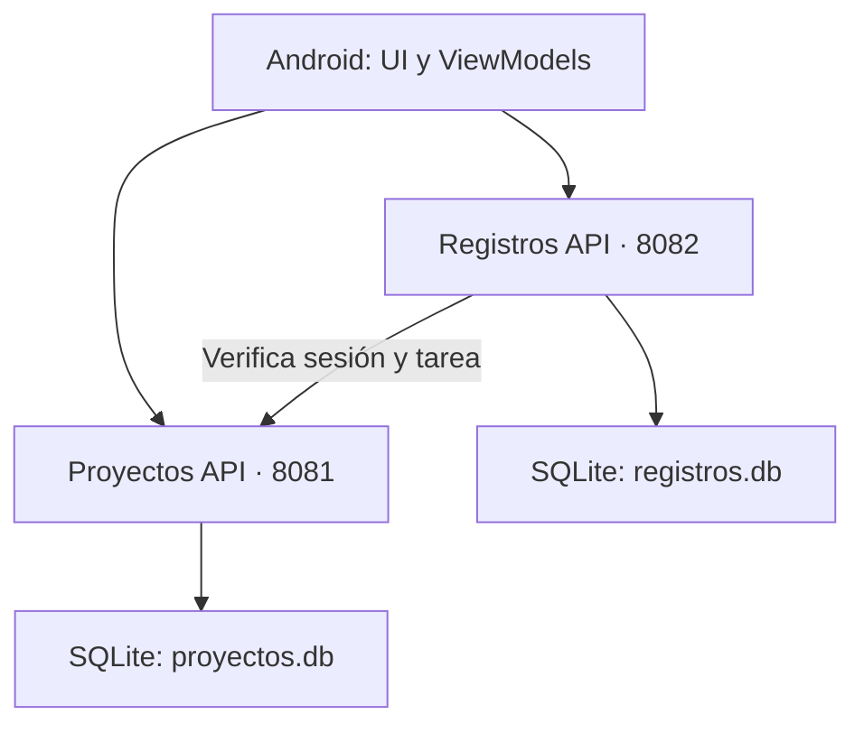

# Deepsource — documentación técnica

Esta página describe la versión 1.6 y su evidencia. Los cambios de acceso de la versión 1.7 están en [Acceso a Deepsource](LOGIN_Y_CONEXION.md).

Evaluación Parcial 4, DSY1105. Corte del documento: 26 de noviembre de 2026.

**Integrantes:** Vicente Jose Duran Leal; segundo integrante y número de equipo por completar. Los enlaces reales del repositorio GitHub y tablero Trello deben incorporarse antes de entregar.

## 1. Contexto y problema

El contexto simulado es un equipo de desarrollo que registra sus horas en notas o planillas separadas. Esto dificulta conocer cuánto tiempo consume cada tarea, corregir registros y comparar el trabajo realizado con la estimación del proyecto.

Deepsource permite registrar el tiempo desde un teléfono Android, asociarlo a proyectos y tareas, consultar el resumen mensual y exportarlo como CSV. Una tarea admite varios registros. El caso se relaciona con el EFT mediante una solución móvil contextualizada, persistencia, servicios propios, integración externa y pruebas verificables. La correspondencia final con el caso y pauta EFT del curso debe confirmarse con el docente.

El usuario principal es una persona que necesita registrar y revisar su propio trabajo. Esta versión no incorpora administración de equipos o aprobación de horas por un líder.

## 2. Alcance funcional

| Función | Comportamiento implementado |
| --- | --- |
| Correo y contraseña | Registro, inicio/cierre de sesión y validaciones. Cuentas locales o de servidor según la variante. |
| Demostración | Acceso sin cuenta, con datos locales separados de los de servidor. |
| Proyectos | Creación, consulta y estimación en horas. La API también permite actualizar y eliminar; estas dos acciones faltan en la UI. |
| Tareas | Tareas predefinidas y creación de tareas propias por proyecto. Una tarea agrupa varios registros. |
| Horas | Crear, consultar, editar y eliminar registros; búsqueda, filtro mensual y CSV. |
| Cronómetro | Iniciar, pausar, reanudar y terminar. Guarda minutos completos redondeados hacia arriba. |
| Resumen | Totales mensuales y comparación con estimaciones. |
| Recursos nativos | Cámara, galería, exportación de documentos y widget del escritorio. |

## 3. Arquitectura y tecnologías

Android utiliza Kotlin, Jetpack Compose, Material 3, ViewModel, estado observable con `mutableStateOf`, coroutines y Retrofit/Gson. Los microservicios utilizan Java, Spring Boot, Spring JDBC y SQLite. No se utiliza JPA en este proyecto.



Dentro de Android, las pantallas reciben un ViewModel. Los ViewModels coordinan las acciones mediante `AppState`, que mantiene la sesión, la navegación y el estado compartido. Los repositorios resuelven las operaciones locales o remotas. Las reglas de duración, validación y exportación se concentran en `domain`.

| Ubicación | Responsabilidad |
| --- | --- |
| `app/src/main/java/com/example/deepsource/ui/screens` | Pantallas Compose. |
| `ui/components` y `ui/theme` | Controles reutilizables, colores y tipografía. |
| `ui/viewmodel` | Acciones y datos expuestos a cada pantalla. |
| `domain` | Modelos y reglas de negocio. |
| `data` | Repositorios, SQLite, sesión y fotos. |
| `data/remote` | Contratos Retrofit y tratamiento de respuestas. |
| `widget` | Widget nativo y sus acciones. |
| `backend/proyectos-service` | Identidad, sesiones, proyectos y tareas. |
| `backend/registros-service` | Registros, límites y resúmenes. |

Para las pruebas, `LoginViewModel` recibe un contrato `LoginActions`; su adaptador de producción continúa utilizando `AppState`. Los repositorios remotos reciben interfaces Retrofit sustituibles. Esto permite comprobar las decisiones sin utilizar cuentas ni conexiones reales. Los dobles de prueba no sustituyen los servicios en la app distribuida.

## 4. Persistencia y relaciones

### Servidor

`proyectos.db` contiene `users`, `sessions`, `projects` y `tasks`. Un usuario tiene proyectos y sesiones; un proyecto tiene tareas. Las tareas tienen un nombre único dentro de cada proyecto.

`registros.db` contiene `entries`: identificador, UID, nombre del usuario, proyecto, tarea, fecha, segundos, origen y clave de reintento. Un usuario puede guardar varios registros para la misma tarea. La combinación `(uid, client_key)` es única.

Los dos archivos son bases SQLite reales, persistentes, creadas desde los scripts `schema.sql`. La relación tarea–registro cruza servicios y se comprueba por HTTP; no es una clave foránea entre archivos independientes. Las consultas JDBC reciben parámetros.

### Dispositivo

`deepsource.db`, versión 3, guarda demostración, variante local, cronómetros y caché para el widget. Las migraciones incorporan tareas y separan el ID del servidor del ID local, conservando registros anteriores. `local_accounts.db` guarda las cuentas del modo local. Las fotos se almacenan en archivos privados por UID.

La caché del servidor no convierte un fallo de red en una escritura local exitosa. Las cuentas creadas en modo local no se convierten automáticamente en cuentas de servidor.

## 5. Reglas de negocio

1. El registro requiere proyecto, tarea, fecha y duración positiva. No se permiten fechas futuras ni más de 24 horas acumuladas por usuario y día.
2. El cronómetro conserva milisegundos activos; las pausas no suman. La pantalla muestra horas y minutos.
3. Al terminar, se redondea una vez hacia arriba: 1 h 33 min 30 s produce 1 h 34 min. Un tiempo positivo inferior a un minuto produce un minuto. Cero no se guarda.
4. Si el cronómetro cruza medianoche, el registro corresponde al día de finalización.
5. La clave persistente de cada cronómetro se reutiliza al reintentar. Se limpia el cronómetro local después de confirmar el registro remoto.
6. El servidor obtiene el usuario desde la sesión y comprueba que la tarea y el proyecto le pertenecen.
7. La exportación CSV escapa comillas y neutraliza prefijos que podrían interpretarse como fórmulas en una planilla.

## 6. Autenticación y manejo de errores

Las contraseñas se derivan con PBKDF2-HMAC-SHA256, sal aleatoria y 210.000 iteraciones. El servidor conserva un resumen del token de sesión y una fecha de caducidad. En Android, `SessionVault` cifra la sesión con AES-GCM y Android Keystore. Después de cinco intentos incorrectos se aplica un bloqueo temporal.

Los endpoints protegidos reciben `Authorization: Bearer <token>`. Un UID enviado por el cliente no reemplaza esa validación.

Los formularios muestran el motivo junto al campo inválido. Los repositorios traducen fallos de conexión a mensajes comprensibles, conservan el estado HTTP y permiten propagar cancelaciones de coroutines. Una respuesta vacía no se considera una operación de lectura exitosa.

## 7. API propia y externa

El inventario completo de endpoints, cuerpos y puertos está en [backend/README.md](../backend/README.md).

Ejemplo para crear un registro, con token de sesión válido:

```http
POST /api/registros
Authorization: Bearer <token>
Idempotency-Key: <clave-del-borrador>
Content-Type: application/json

{"projectId":"<proyecto>","taskId":"<tarea>","day":"2026-11-20","seconds":5610,"source":"Cronómetro"}
```

El servidor aproxima este ejemplo a 5.640 segundos. Los IDs deben existir y pertenecer a la cuenta autenticada.

El consumo de una API externa está pendiente. Debe seleccionarse una integración que aporte información útil a la app y demostrarse funcionando.

## 8. Instalación, pruebas y firma

La puesta en marcha está en [README.md](../README.md) y [INSTRUCCIONES.md](GUIA_USO.md). Las pruebas y sus resultados están en [PRUEBAS.md](PRUEBAS.md). El proceso de firma está en [APK_FIRMADO.md](APK_FIRMADO.md).

La variante `server` es la conectada al backend y la predeterminada. La variante `local` utiliza almacenamiento del dispositivo. Ambas incluyen demostración.

## 9. Estado comprobado y limitaciones

- Compilación directa de las fuentes Kotlin/Compose y 77 pruebas unitarias Android aprobadas.
- 15 pruebas backend aprobadas en esta verificación, con SQLite real temporal y dobles para comunicaciones externas.
- Fuentes de pruebas instrumentadas compiladas; ejecución en dispositivo pendiente.
- Cobertura de líneas: dominio 87,58 %; conjunto lógico ampliado 19,89 %. El mínimo global del 80 % permanece pendiente.
- Clave release propia generada, certificado exportado y configuración preparada. El APK nuevo no pudo generarse por las restricciones de Gradle en el entorno de trabajo.
- Pendientes la ejecución conjunta en emulador, la integración de una API externa y las capturas reales de funcionamiento.

No se afirma una ejecución exitosa de la app completa ni una firma de APK mientras falten esas comprobaciones. La matriz de entrega está en [ENTREGA_EVA4.md](ENTREGA_EVA4.md).
